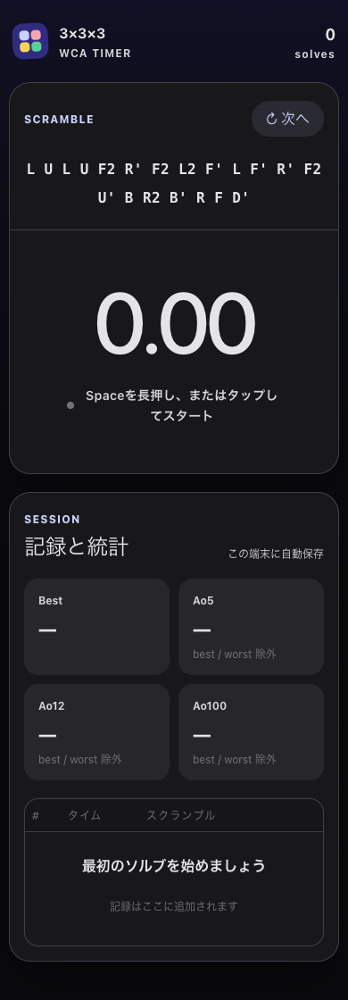

# 現行 UI の仕様

Cube Practice Timer のトップ画面（`/`）を対象とする。2026年11月20日にソースとローカルの Chromium で確認した。

README に「Material Design 3を基調」と記載がある。現行画面は Next.js、React、Tailwind CSS で実装しており、配色・文字・余白は Tailwind のユーティリティで指定している。以下の Material Design 3（M3）との対応は、公式ガイドをもとに今回整理したもの。画面を再現する場合は、このページの実装値を参照する。

## 画面の構成

スクランブルを確認し、計測し、結果を振り返る順に、ひとつの画面を上から読む。表示の中心はタイムで、数字を載せた面全体が開始・停止のボタンになっている。

| 領域         | 表示と役割                                                                                                                             |
| ------------ | -------------------------------------------------------------------------------------------------------------------------------------- |
| ヘッダー     | 4色のキューブマーク、`3×3×3`、`WCA TIMER`、保存済みの記録数（`solves`）                                                                |
| スクランブル | 中央揃えの手順と「次へ」。未生成時は「生成中…」と表示し、未生成時と計測中は「次へ」を無効にする                                        |
| タイマー     | 中央にタイム、その下に状態を示すドットと操作案内。停止後は確定タイムを表示したまま次のスクランブルを出す                               |
| 記録と統計   | `Best`、`Ao5`、`Ao12`、`Ao100` と「この端末に自動保存」。算出に必要な記録数に達していない値は「—」                                     |
| 履歴         | 新しい順に最大100件を表示。番号、タイム、省略表示したスクランブル、削除ボタン。スクランブルの全文は `title` に設定。削除は即時反映する |
| 履歴の空状態 | 「最初のソルブを始めましょう」「記録はここに追加されます」                                                                             |

### 画面キャプチャ

初回表示の例。スクランブルは表示のたびに変わる。キャプチャでは開発用インジケーターを非表示にした。

[デスクトップ幅 1280 CSS px の画面](assets/timer-desktop.png)

## タイマーの状態と操作

| 状態             | タイムとドット                                                        | 操作案内                                | 入力                                                                                   |
| ---------------- | --------------------------------------------------------------------- | --------------------------------------- | -------------------------------------------------------------------------------------- |
| 待機 `idle`      | Zinc 200 の数字、Zinc 500 のドット。初回は `0.00`                     | Spaceを長押し、またはタップしてスタート | ページ上で Space を押すと準備状態。タイマー面を押すと計測開始                          |
| 準備 `ready`     | Emerald 400 の数字とドット。面に同色5%の塗り、ドットに同色10%のリング | 離してスタート                          | Space を離すと計測開始                                                                 |
| 計測中 `running` | Indigo 200 の数字と明滅するドット。動きを減らす設定では明滅を止める   | 任意のキーまたはタップでストップ        | ページ上のキー入力かタイマー面の操作で停止。記録を追加し、次のスクランブルに切り替える |

Space の押下時間にしきい値は設けていない。ページ全体のキー押下処理は、ボタンにフォーカスがある場合、そのボタンの操作を優先する。タイムは百分の一秒まで切り捨てて表示し、1分以上は `1:01.23` の形式にする。履歴の時間には末尾に `s` が付く。

Ao5・Ao12・Ao100 は直近の対象件数から、最速側と最遅側をそれぞれ5%（端数切り上げ）除いて平均する。記録は端末の Local Storage に保存し、ページを開き直したときに復元する。

## 配色・文字・余白

| 用途                           | 現行の指定                                                                                                        |
| ------------------------------ | ----------------------------------------------------------------------------------------------------------------- |
| ページ背景                     | `zinc-950` を土台に上端の `indigo-950/40` から縦方向にグラデーション                                              |
| 計測・統計パネルと内側のカード | 外側は `zinc-900`、統計タイルは `zinc-800`。枠線と区切りは主に `zinc-700`                                         |
| 本文と補足                     | 基本は `zinc-200`、説明は `zinc-300`、履歴の列見出しや統計の補足は `zinc-500`                                     |
| アクセントと操作               | セクションラベルと「次へ」は `indigo-200`。「次へ」の背景は同色10%、ホバー時20%。履歴の削除はホバー時に `red-300` |
| 文字と数字                     | システムのサンセリフ。スクランブルは等幅。タイム・記録数・統計値は `tabular-nums` で桁の幅を揃える                |
| 文字サイズ                     | タイムは96／128px、統計値は24／30px、スクランブルは16／20px。操作案内は14px、短いラベルと補足は主に12px           |
| 角丸と間隔                     | 大パネル24px、タイルと履歴の枠16px、ボタンはピル型または円。領域間20px、統計タイル間10px                          |
| コンテナ                       | 最大幅64rem、中央寄せ。スクランブルと計測のブロック、統計と履歴のブロックを縦に積む                               |

上の px 値はルート文字サイズが16pxの場合。ブレークポイントは Tailwind の既定値を使う。

| 幅                     | タイマー面の最小高さ | タイム | 統計 |
| ---------------------- | -------------------- | ------ | ---- |
| 640px 未満             | 272px                | 96px   | 2列  |
| 640px 以上、768px 未満 | 300px                | 128px  | 2列  |
| 768px 以上             | 360px                | 128px  | 4列  |

## Material Design 3 との対応

| M3 の参照項目                            | Cube Practice での読み替え                                                                                                        |
| ---------------------------------------- | --------------------------------------------------------------------------------------------------------------------------------- |
| Surface / Surface container / On surface | 全体背景、パネル、文字の色を用途ごとに対応付ける。現行の Zinc の階調が起点になる                                                  |
| Display / Headline / Body / Label        | 大きなタイム、統計見出し、操作案内、短いラベルに役割を割り当てる。数値のサイズと等幅のスクランブルはアプリ固有の指定を使う        |
| Cards / Buttons                          | 統計タイルと操作ボタンのまとまり方を考えるときに参照する。全面を押せるタイマーと待機・準備・計測中の色は Cube Practice 固有の仕様 |

参照先は [M3 の色の役割](https://m3.material.io/styles/color/the-color-system/)、[タイポグラフィ](https://m3.material.io/styles/typography/type-scale-tokens)、[カード](https://m3.material.io/components/cards/overview)、[ボタン](https://m3.material.io/components/buttons/overview)。

## 実装の参照先

- [画面と状態](../../web/src/features/timer/components/TimerWorkspace.tsx)
- [ページの幅と余白](../../web/src/app/page.tsx)
- [ダークテーマと背景](../../web/src/app/layout.tsx)
- [タイムの表示形式](../../packages/timerDomain/src/formatTime.ts)と[統計計算](../../packages/timerDomain/src/statistics.ts)
- [機能を追加するときの UX・UI 設計フロー](workflow.md)
- [デザインシステムの導入計画](design-system.md)
